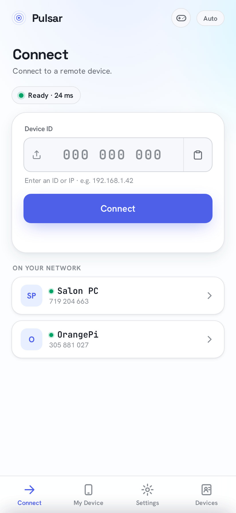
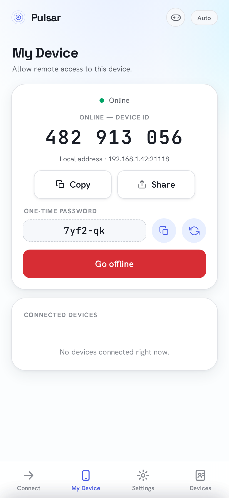
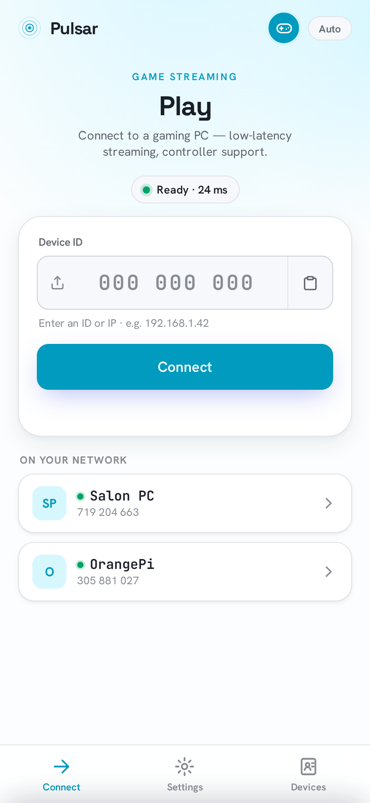

<p align="center">
  
</p>

<h1 align="center">Pulsar Mobile</h1>

<p align="center">
  Control your computer from your phone, or share your phone's screen. A free, open-source alternative to TeamViewer, AnyDesk and Parsec. 📱
</p>

<p align="center">
  
  <a href="https://github.com/PulsarDesk/pulsar-mobile/releases"></a>
  <a href="https://github.com/PulsarDesk/pulsar-mobile/actions/workflows/ci.yml"></a>
  <a href="LICENSE"></a>
</p>

---

## 🚀 Project Status
**Current Status:** Alpha (0.x). Android works: connect to a computer with touch, mouse and keyboard, or share the
phone's screen and let someone control it. iOS is not available yet.

<p align="center">
  
  
  
</p>

---

## 📦 Other Pulsar Repositories
- [**pulsar-desktop**](https://github.com/PulsarDesk/pulsar-desktop) - Pulsar for Windows, macOS and Linux
- [**relay**](https://github.com/PulsarDesk/relay) - Run your own relay server
- [**pulsar-core**](https://github.com/PulsarDesk/pulsar-core) - The shared engine behind both apps

---

## ⚡ Trying Pulsar Mobile
Download [`Pulsar-android.apk`](https://github.com/PulsarDesk/pulsar-mobile/releases/latest/download/Pulsar-android.apk)
from the [latest release](https://github.com/PulsarDesk/pulsar-mobile/releases/latest) and install it. The app
updates itself after that.

- **Letting others control the phone** needs Pulsar's accessibility service. Android may block it for apps installed
  from a file: App info -> ⋮ -> **Allow restricted settings**, then turn it on.
- **Android TV:** the app is navigated with the remote's D-pad.

---

## 📱 Where it has been tested
| Device | Connect to a computer | Share this phone |
|---|---|---|
| Samsung Galaxy Z Flip4 | ✅ | ✅ |
| Android emulator (Android 15) | ✅ | ❔ partly |
| Android TV | ❔ not tested on a real TV yet | ❔ |
| iPhone / iPad | ❌ not available yet | ❌ |

Needs Android 7.0 or newer. Tried it on another phone? A short note in an
[issue](https://github.com/PulsarDesk/pulsar-mobile/issues) helps, even when everything worked.

---

## 🐞 Reporting a bug
[Open an issue](https://github.com/PulsarDesk/pulsar-mobile/issues/new/choose) and include:

- Pulsar version, phone model and Android version
- The other side: computer or phone, its system and Pulsar version
- What you did and what happened (black screen, no connection, touch not working, crash, ...)
- A screen recording, if you can

---

## 🛠️ Requirements
**To use:** an Android 7.0+ phone, tablet or TV.

**For contributors / development:** Rust stable, [bun](https://bun.sh), the Android SDK + NDK and JDK 17.

---

## 🤝 Contributing
Everyone can open [issues](https://github.com/PulsarDesk/pulsar-mobile/issues) and pull requests. Irrelevant or
abusive issues may be closed or removed. Commits follow [Conventional Commits](https://www.conventionalcommits.org).

### Development Guide
```bash
git clone https://github.com/PulsarDesk/pulsar-mobile.git
cd pulsar-mobile/mobile
bun install
bun run tauri android dev    # needs a device or emulator
```

More: [docs/development.md](docs/development.md) (layout, releases, signing, the accessibility service).

---

## 📄 License
Pulsar is licensed under **GNU GPLv3 or later** (GPL-3.0-or-later). See the [LICENSE](LICENSE) file for details.
