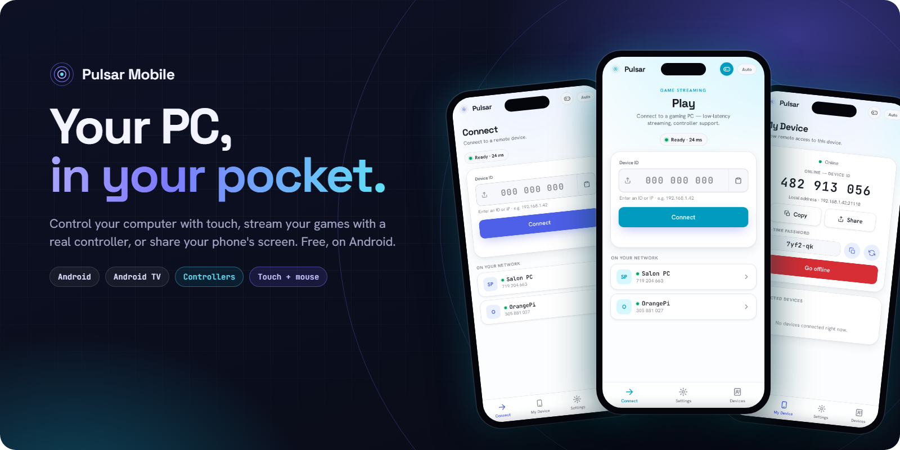
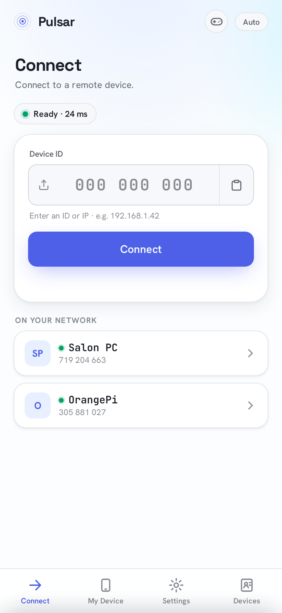
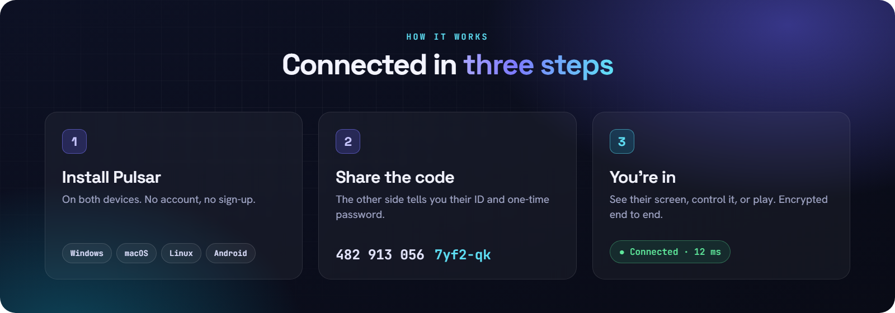

<p align="center">
  <a href="https://pulsardesk.com"></a>
</p>

<h3 align="center">Your computer and your games, on your phone. Free.</h3>

<p align="center">
  Control a computer with touch, play your PC games with a real controller, or let someone help you on your phone.<br>
  A free, open-source alternative to TeamViewer, AnyDesk and Parsec. <b>No account, no subscription, no tracking.</b>
</p>

<p align="center">
  <a href="https://github.com/PulsarDesk/pulsar-mobile/releases/latest/download/Pulsar-android.apk"></a>
  <a href="https://github.com/PulsarDesk/pulsar-desktop/releases/latest"></a>
</p>

<p align="center">
  <a href="https://github.com/PulsarDesk/pulsar-mobile/releases"></a>
  <a href="https://github.com/PulsarDesk/pulsar-mobile/actions/workflows/ci.yml"></a>
  <a href="https://github.com/PulsarDesk/pulsar-mobile/releases"></a>
  <a href="https://github.com/PulsarDesk/pulsar-mobile/stargazers"></a>
  <a href="LICENSE"></a>
</p>

<p align="center">
  <a href="https://pulsardesk.com"><b>Website</b></a> ·
  <a href="#-get-pulsar-mobile"><b>Download</b></a> ·
  <a href="#-questions"><b>FAQ</b></a> ·
  <a href="https://github.com/PulsarDesk/pulsar-desktop"><b>Desktop app</b></a> ·
  <a href="https://github.com/PulsarDesk/pulsar-mobile/issues/new/choose"><b>Report a bug</b></a>
</p>

## 💜 Why Pulsar Mobile?

<table>
<tr>
<td width="33%" valign="top">

### 🖐️ Made for touch
Use your finger like a trackpad, or tap exactly where you want to click. Two fingers scroll, and a keyboard with Ctrl+Alt+Del is always one tap away.

</td>
<td width="33%" valign="top">

### 🎮 Your PC games, anywhere
Pair a controller, pick a game from your PC's library and play. Rumble works, and you see the controller's
battery level.

</td>
<td width="33%" valign="top">

### 🔒 Private and free
Always end-to-end encrypted. No account, no ads, no tracking, and nothing to pay. Open source under GPLv3.

</td>
</tr>
</table>

## 👀 A look inside

<p align="center">
  
  &nbsp;
  
  &nbsp;
  
</p>
<p align="center">
  <b>Connect</b> to any computer &nbsp;·&nbsp; <b>Play</b> your PC games &nbsp;·&nbsp; <b>Share</b> your own phone
</p>

## 🚀 How it works

<p align="center"></p>

Install [Pulsar Desktop](https://github.com/PulsarDesk/pulsar-desktop) on the computer, type its ID and password on
your phone, and you're in. Computers on the same Wi-Fi show up on their own.

## ✨ What you can do

### 🖥️ Use your computer from the couch, the train or the office
- **Mouse or touch mode:** a trackpad-style cursor, or tap right on the spot. Tap, double-tap, long-press, drag and
  two-finger scroll.
- **Keyboard included:** an on-screen keyboard with Ctrl+Alt+Del, or plug in a real mouse and keyboard.
- **Files, clipboard, chat:** send files both ways, copy on one side and paste on the other, and chat.
- **Hear it, talk to it:** the computer's sound plays on your phone, and your phone's microphone works on the
  computer.
- **Any screen, any way:** pick which monitor to view; fit, fill or stretch; portrait or landscape.
- **Several computers at once,** with a quick switcher, plus saved devices with favourites, search and icons.

### 🎮 Play your PC games
- **Game mode:** stream the whole desktop, one screen, or a game picked from the computer's library.
- **Real controllers** over Bluetooth or USB, with rumble. The PC sees an Xbox 360 controller or a DualShock 4,
  your pick.
- **Picture your way:** H.264 / H.265, HDR, resolution, frame rate, and presets from *Data saver* to
  *Low latency*, with a live overlay showing fps, ping and loss.
- **On the big screen:** on Android TV, the whole app works with the remote's D-pad.

### 📱 Get help on your phone
- **Share your screen** with someone you trust and let them tap for you.
- **You approve** who connects, see who is connected, and disconnect them any time.

### 🔒 Safe by default
- **Always end-to-end encrypted:** even the relay server only forwards data it cannot read.
- **You decide who gets in:** a one-time password, a permanent password, unattended access and two-factor codes.
- **Direct first, relay when needed,** or force either one. Use your own server, or **run a relay on the phone**
  for your Wi-Fi.
- **Updates itself.** In English, Turkish, Russian and Kazakh.

## 📥 Get Pulsar Mobile

Download **[`Pulsar-android.apk`](https://github.com/PulsarDesk/pulsar-mobile/releases/latest/download/Pulsar-android.apk)**
from the [latest release](https://github.com/PulsarDesk/pulsar-mobile/releases/latest) and install it. The app keeps
itself up to date after that.

> [!TIP]
> **Want others to control your phone?** That needs Pulsar's accessibility service. Android may block it for apps
> installed from a file: open *App info* → ⋮ → **Allow restricted settings**, then turn it on.

Needs **Android 7.0** or newer. iPhone and iPad are not available yet.

## ❓ Questions

<details>
<summary><b>What do I need on the computer?</b></summary>
<br>
The free <a href="https://github.com/PulsarDesk/pulsar-desktop">Pulsar Desktop</a> app for Windows, macOS or Linux.
Open it, and it shows the ID and password to type on your phone.
</details>

<details>
<summary><b>Does it work outside my home Wi-Fi?</b></summary>
<br>
Yes. Pulsar connects directly whenever it can and falls back to a relay server automatically when it can't, so it
works on mobile data and other networks too.
</details>

<details>
<summary><b>Can I play games on mobile data?</b></summary>
<br>
Yes. The stream adapts to your connection. The <i>Data saver</i> preset keeps data use low; on Wi-Fi, pick
<i>Low latency</i> for the snappiest play.
</details>

<details>
<summary><b>Is it safe?</b></summary>
<br>
Every session is end-to-end encrypted, always. Nobody can connect without the password or your approval, and you
can disconnect anyone at any time.
</details>

<details>
<summary><b>Is there an iPhone version?</b></summary>
<br>
Not yet. Android (phones, tablets and Android TV) comes first.
</details>

## 🧪 Where it has been tested

| Device | Connect to a computer | Share this phone |
|---|---|---|
| Samsung Galaxy Z Flip4 | ✅ | ✅ |
| Android emulator (Android 15) | ✅ | ❔ partly |
| Android TV | ❔ not tested on a real TV yet | ❔ |
| iPhone / iPad | ❌ not available yet | ❌ |

Pulsar is in **alpha** (0.x): expect rough edges. Tried it on another phone? A short note in an
[issue](https://github.com/PulsarDesk/pulsar-mobile/issues) helps, even when everything worked.

## 🐞 Reporting a bug

[Open an issue](https://github.com/PulsarDesk/pulsar-mobile/issues/new/choose) and include:

- Pulsar version, phone model and Android version
- The other side: computer or phone, its system and Pulsar version
- What you did and what happened (black screen, no connection, touch not working, crash, ...)
- A screen recording, if you can

## 🌌 The Pulsar family

| | Project | |
|---|---|---|
| 🖥️ | [**Pulsar Desktop**](https://github.com/PulsarDesk/pulsar-desktop) | Pulsar for Windows, macOS and Linux |
| 🛰️ | [**Pulsar Relay**](https://github.com/PulsarDesk/relay) | Run your own Pulsar server |
| 🧩 | [**pulsar-core**](https://github.com/PulsarDesk/pulsar-core) | The shared engine behind both apps |
| 🌐 | [**pulsardesk.com**](https://pulsardesk.com) | The website |

## 🛠️ For developers

<details>
<summary>Build Pulsar Mobile from source</summary>

**Needs:** Rust stable, [bun](https://bun.sh), the Android SDK + NDK and JDK 17.

```bash
git clone https://github.com/PulsarDesk/pulsar-mobile.git
cd pulsar-mobile/mobile
bun install
bun run tauri android dev    # needs a device or emulator
```

More: [docs/development.md](docs/development.md) (layout, releases, signing, the accessibility service).

</details>

Everyone is welcome to open [issues](https://github.com/PulsarDesk/pulsar-mobile/issues) and pull requests.
Irrelevant or abusive issues may be closed or removed. Commits follow
[Conventional Commits](https://www.conventionalcommits.org).

## 📄 License

Pulsar is free software under the **GNU GPLv3 or later** (GPL-3.0-or-later). See [LICENSE](LICENSE).

<p align="center">
  <br>
  <b>Like Pulsar? A ⭐ helps other people find it.</b>
</p>
