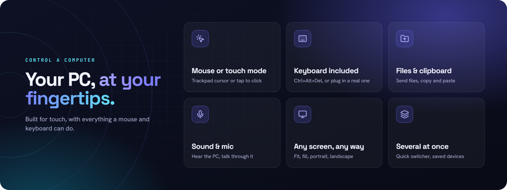
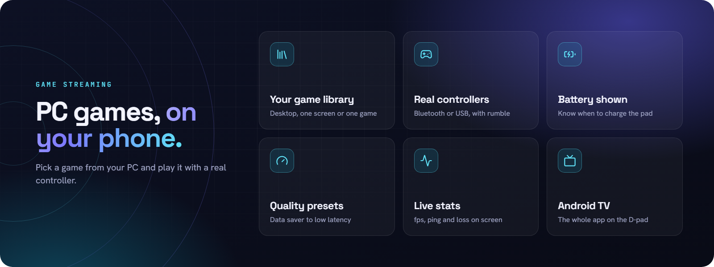
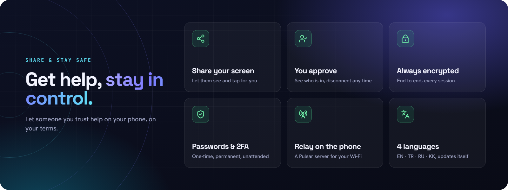
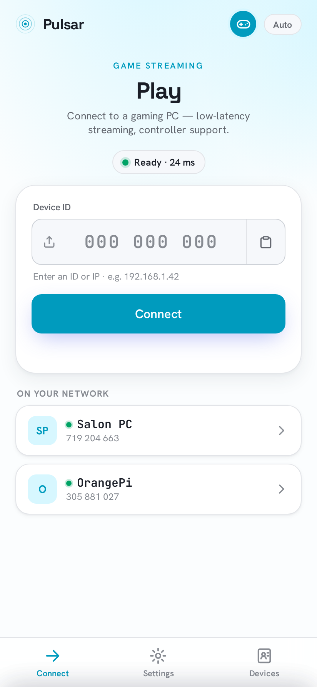
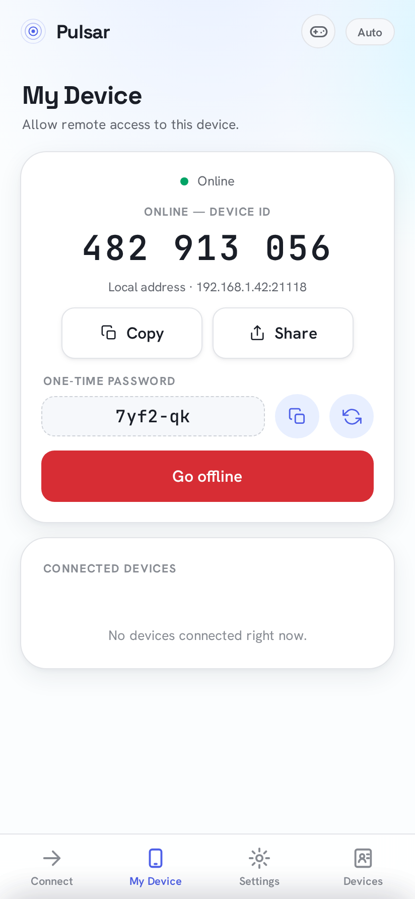

<p align="center">
  <a href="https://pulsardesk.com"></a>
</p>

<h3 align="center">Your computer and your games, on your phone. Free.</h3>

<p align="center">
  A free, open-source alternative to TeamViewer, AnyDesk and Parsec. <b>No account, no subscription, no tracking.</b>
</p>

<p align="center">
  <a href="https://github.com/PulsarDesk/pulsar-mobile/releases/latest/download/Pulsar-android.apk"></a>
  <a href="https://github.com/PulsarDesk/pulsar-desktop/releases/latest"></a>
</p>

<p align="center">
  <a href="https://github.com/PulsarDesk/pulsar-mobile/releases"></a>
  <a href="https://github.com/PulsarDesk/pulsar-mobile/actions/workflows/ci.yml"></a>
  <a href="https://github.com/PulsarDesk/pulsar-mobile/releases"></a>
  <a href="https://github.com/PulsarDesk/pulsar-mobile/stargazers"></a>
  <a href="LICENSE"></a>
</p>

<p align="center"></p>

<p align="center"></p>

<p align="center"></p>

<p align="center"></p>

<p align="center">
  
  &nbsp;
  
  &nbsp;
  
</p>

## 📥 Get Pulsar Mobile

Download **[`Pulsar-android.apk`](https://github.com/PulsarDesk/pulsar-mobile/releases/latest/download/Pulsar-android.apk)**
and install it; it updates itself after that. Needs **Android 7.0+**. On the computer, install
[Pulsar Desktop](https://github.com/PulsarDesk/pulsar-desktop). iPhone and iPad are not available yet.

> [!TIP]
> **Letting others control your phone** needs Pulsar's accessibility service. If Android blocks it: *App info* → ⋮ →
> **Allow restricted settings**, then turn it on.

## ❓ Questions

<details><summary><b>Does it work outside my home Wi-Fi?</b></summary><br>
Yes. Pulsar connects directly when it can and falls back to a relay automatically, so mobile data works too. The
<i>Data saver</i> preset keeps data use low.
</details>

<details><summary><b>Is it safe?</b></summary><br>
Every session is end-to-end encrypted. Nobody connects without the password or your approval, and you can
disconnect anyone at any time.
</details>

<details><summary><b>Is it finished?</b></summary><br>
Not yet: Pulsar is in <b>alpha</b> (0.x). Expect rough edges and
<a href="https://github.com/PulsarDesk/pulsar-mobile/issues/new/choose">tell us what you hit</a>.
</details>

## 📚 More

<details>
<summary><b>🧪 Where it has been tested</b></summary>

| Device | Connect to a computer | Share this phone |
|---|---|---|
| Samsung Galaxy Z Flip4 | ✅ | ✅ |
| Android emulator (Android 15) | ✅ | ❔ partly |
| Android TV | ❔ not tested on a real TV yet | ❔ |
| iPhone / iPad | ❌ not available yet | ❌ |

Tried it on another phone? A short note in an [issue](https://github.com/PulsarDesk/pulsar-mobile/issues) helps.

</details>

<details>
<summary><b>✨ Full feature list</b></summary>

- **Control:** mouse (trackpad) or touch mode; tap, double-tap, long-press, drag, two-finger scroll; on-screen
  keyboard with Ctrl+Alt+Del; external mice and keyboards.
- **Session:** file transfer both ways, clipboard, chat, the computer's sound, your phone's microphone; pick a
  monitor; fit / fill / stretch; portrait or landscape; several sessions with a quick switcher; saved devices with
  favourites, search and icons.
- **Game mode:** stream the desktop, one screen or a game from the computer's library; controllers over Bluetooth
  or USB with rumble and battery level; the PC sees an Xbox 360 pad or a DualShock 4 (your pick).
- **Picture:** H.264 / H.265, HDR, resolution, frame rate, bitrate, presets from *Data saver* to *Low latency*,
  live stats overlay (fps, ping, loss).
- **Share this phone:** share the screen, approve or deny, see and disconnect connected devices.
- **Security & network:** always end-to-end encrypted; one-time password, permanent password, unattended access,
  two-factor codes; direct first with relay fallback, or forced either way; your own relay, or a relay running on
  the phone.
- **Android TV** D-pad navigation; updates itself; English, Turkish, Russian and Kazakh.

</details>

<details>
<summary><b>🐞 Reporting a bug</b></summary>

[Open an issue](https://github.com/PulsarDesk/pulsar-mobile/issues/new/choose) and include:

- Pulsar version, phone model and Android version
- The other side: computer or phone, its system and Pulsar version
- What you did and what happened (black screen, no connection, touch not working, crash, ...)
- A screen recording, if you can

</details>

<details>
<summary><b>🛠️ Build from source</b></summary>

**Needs:** Rust stable, [bun](https://bun.sh), the Android SDK + NDK and JDK 17.

```bash
git clone https://github.com/PulsarDesk/pulsar-mobile.git
cd pulsar-mobile/mobile
bun install
bun run tauri android dev    # needs a device or emulator
```

More: [docs/development.md](docs/development.md). Issues and pull requests are welcome; commits follow
[Conventional Commits](https://www.conventionalcommits.org).

</details>

---

<p align="center">
  <a href="https://github.com/PulsarDesk/pulsar-desktop">🖥️ Pulsar Desktop</a> ·
  <a href="https://github.com/PulsarDesk/relay">🛰️ Pulsar Relay</a> ·
  <a href="https://github.com/PulsarDesk/pulsar-core">🧩 pulsar-core</a> ·
  <a href="https://pulsardesk.com">🌐 pulsardesk.com</a>
</p>

<p align="center">
  <sub>Free software under the <a href="LICENSE">GNU GPLv3 or later</a>. Like Pulsar? A ⭐ helps other people find it.</sub>
</p>
